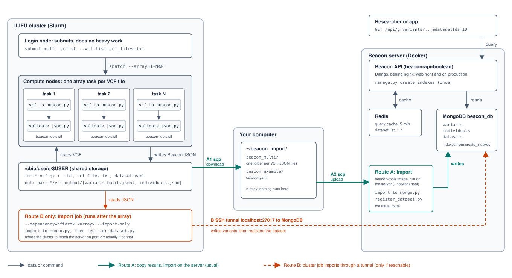

# Loading VCF Data into Beacon v2 on ILIFU

This guide walks through transforming your VCF files (any cohort or dataset) into GA4GH Beacon v2 format and loading it into the production MongoDB instance.

## Contents

- [1. Architecture Overview](#1-architecture-overview)
- [2. Prerequisites](#2-prerequisites)
- [3. Quick Start (Automated Pipeline)](#3-quick-start-automated-pipeline)
  - [3.1 Using your own data](#31-using-your-own-data)
  - [3.2 Pipeline Options](#32-pipeline-options)
- [4. Step-by-Step Guide (Single VCF File)](#4-step-by-step-guide-single-vcf-file)
  - [4.1 Step 1: Get a Compute Node](#41-step-1-get-a-compute-node)
  - [4.2 Step 2: Install the Tools](#42-step-2-install-the-tools)
  - [4.3 Step 3: Locate Your VCF Files](#43-step-3-locate-your-vcf-files)
  - [4.4 Step 4: Transform VCF to Beacon JSON](#44-step-4-transform-vcf-to-beacon-json)
  - [4.5 Step 5: Transform Phenotype Data (Optional)](#45-step-5-transform-phenotype-data-optional)
  - [4.6 Step 6: Validate](#46-step-6-validate)
  - [4.7 Step 7: Import to Production MongoDB](#47-step-7-import-to-production-mongodb)
  - [4.8 Step 8: Verify](#48-step-8-verify)
- [5. Step-by-Step Guide (Multi VCF Files)](#5-step-by-step-guide-multi-vcf-files)
  - [5.1 Step 1: Get a Shell where `sbatch` Works](#51-step-1-get-a-shell-where-sbatch-works)
  - [5.2 Step 2: Install the Tools](#52-step-2-install-the-tools)
  - [5.3 Step 3: List the VCF Files](#53-step-3-list-the-vcf-files)
  - [5.4 Step 4: Preview the Jobs (Optional)](#54-step-4-preview-the-jobs-optional)
  - [5.5 Step 5: Submit the Transform and Validate Jobs](#55-step-5-submit-the-transform-and-validate-jobs)
  - [5.6 Step 6: Watch the Jobs](#56-step-6-watch-the-jobs)
  - [5.7 Step 7: Import and Register the Dataset](#57-step-7-import-and-register-the-dataset)
  - [5.8 Step 8: Verify](#58-step-8-verify)
- [6. Performance Tuning](#6-performance-tuning)
  - [6.1 For Large Datasets (>10M variants)](#61-for-large-datasets-10m-variants)
  - [6.2 SLURM Resource Requests](#62-slurm-resource-requests)
  - [6.3 Using Screen/Tmux for Long Runs](#63-using-screentmux-for-long-runs)
- [7. Troubleshooting](#7-troubleshooting)
  - [7.1 Common Issues](#71-common-issues)
  - [7.2 Checking Pipeline Output](#72-checking-pipeline-output)
  - [7.3 The Beacon itself: build, containers and queries](#73-the-beacon-itself-build-containers-and-queries)
- [8. Tool Reference](#8-tool-reference)
- [9. Verification Checklist](#9-verification-checklist)

## 1. Architecture Overview



*The path of a dataset. On the cluster, a Slurm array converts and validates one
VCF per task. The results then reach MongoDB by one of two routes. Route A
(solid green) copies them through your computer to the Beacon server and imports
there; it is the usual route, because ILIFU compute nodes normally cannot reach
the Beacon servers. Route B (dashed orange) lets a cluster job import through an
SSH tunnel, and works only when the cluster can reach the server. The vector
source is in [diagrams/](diagrams/README.md).*

**Why ILIFU?** VCF transformation is compute-intensive (parsing millions of variants). ILIFU compute nodes provide the CPU, memory, and direct access to the data on `/cbio` that this requires.

## 2. Prerequisites

| Requirement | Details |
|---|---|
| ILIFU SSH access | `ssh <your-ilifu-username>@slurm.ilifu.ac.za` (or the `ilifu` alias below) |
| Beacon server SSH | `ssh <your-ssh-alias>` |
| Container runtime | Singularity/Apptainer on ILIFU, or Docker on a server (Step 2) |
| VCF data | `.vcf.gz` files in `/cbio/dbs/` or `/cbio/projects/` |

Your ILIFU username is the one you were given when your account was created; it
is not necessarily the username on your own computer. To avoid typing it every
time, add an alias to `~/.ssh/config` on your own computer, once:

```text
Host ilifu
    HostName slurm.ilifu.ac.za
    User <your-ilifu-username>
```

Then `ssh ilifu` is the same as `ssh <your-ilifu-username>@slurm.ilifu.ac.za`.

## 3. Quick Start (Automated Pipeline)

The fastest path: one script does everything. Paths in this guide use `$USER`,
your ILIFU username, so the commands work for any user as written.

The steps below run on a small public example (nine 1000 Genomes individuals on
chromosome 22, plus a made-up phenotype file) so you can see a correct run
before you use your own files. It stops before any database import. To use your
own data, see section 3.1 after the steps.

```bash
# 1. SSH into ILIFU (from your own computer)
ssh <your-ilifu-username>@slurm.ilifu.ac.za   # or: ssh ilifu

# 2. Get a compute node (NEVER run on login node)
srun --pty --nodes=1 --ntasks-per-node=1 --cpus-per-task=4 \
     --mem=32G --time=7-0:0:0 --nodelist=compute-[205,209] bash

# 3. Get the repository and the tools image (once)
cd /cbio/users/$USER
git clone https://github.com/AfriGen-D/variant-checker-beacon.git
singularity pull beacon-tools.sif docker://ghcr.io/afrigen-d/variant-checker-beacon/beacon-tools:latest

# 4. Download the example data: four small files (about 70 KB) from GitHub
mkdir -p /cbio/users/$USER/beacon_example
cd /cbio/users/$USER/beacon_example
RAW=https://raw.githubusercontent.com
BASE=$RAW/AfriGen-D/variant-checker-beacon/main/examples
for f in 1000G_chr22_subset.vcf.gz 1000G_chr22_subset.vcf.gz.tbi \
         phenotypes_example.csv dataset.yaml; do
    curl -sSLO "$BASE/$f"
done
ls -l      # expect 4 files; the VCF is about 68 KB

# 5. Run it from the container (nothing to install)
cd /cbio/users/$USER/variant-checker-beacon
EXAMPLE=/cbio/users/$USER/beacon_example
./scripts/run_ilifu_pipeline.sh $EXAMPLE/1000G_chr22_subset.vcf.gz \
    --dataset-file $EXAMPLE/dataset.yaml \
    --phenotypes $EXAMPLE/phenotypes_example.csv \
    --container /cbio/users/$USER/beacon-tools.sif \
    --skip-import
```

A correct run processes 4,231 variants and ends with `Total errors: 0` for each
of the variant, individual and phenotype files. The step-by-step guide below
uses these same files, so you can compare every result with what you get. The
files are also in the `examples/` folder of the repository; its README says
where the data comes from.

### 3.1 Using your own data

Describe your dataset in a short `dataset.yaml`, then point the script at your
VCF. The `id` is the name your data is listed under: choose your own, for
example `AIBST_EXOMES`. There is no default, so data is never filed under
someone else's dataset by accident.

```bash
cd /cbio/users/$USER/variant-checker-beacon
cat > dataset.yaml <<'EOF'
dataset:
  id: MY_DATASET
  name: My dataset
  description: What this data is.
  assembly: GRCh38
EOF

./scripts/run_ilifu_pipeline.sh /path/to/your_data.vcf.gz \
    --dataset-file dataset.yaml \
    --container /cbio/users/$USER/beacon-tools.sif \
    --skip-import
```

Leave out `--skip-import` only when you mean to write to the Beacon's database:
the pipeline then imports your variants and also creates the dataset's record
from `dataset.yaml`, so the dataset appears in the Beacon's dataset list.
(`--dataset-id` also works in place of the file, see Step 4.)

`--container` takes a `.sif` file or a `docker://` URI (run with Singularity or
Apptainer), or a plain Docker image name such as
`ghcr.io/afrigen-d/variant-checker-beacon/beacon-tools:latest` (run with Docker,
on a server or workstation). `--runtime` overrides the choice.

### 3.2 Pipeline Options

```bash
# With phenotype data
./scripts/run_ilifu_pipeline.sh /path/to/data.vcf.gz \
    --dataset-file dataset.yaml \
    --phenotypes /path/to/phenotypes.csv

# Transform + validate only (no MongoDB import)
./scripts/run_ilifu_pipeline.sh /path/to/data.vcf.gz \
    --dataset-file dataset.yaml --skip-import

# Custom assembly and output location
./scripts/run_ilifu_pipeline.sh /path/to/data.vcf.gz \
    --dataset-file dataset.yaml \
    --assembly GRCh37 \
    --output /scratch3/users/$USER/beacon_output

# Preview what will happen (no execution)
./scripts/run_ilifu_pipeline.sh /path/to/data.vcf.gz \
    --dataset-file dataset.yaml --dry-run

# Tune for large datasets
./scripts/run_ilifu_pipeline.sh /path/to/data.vcf.gz \
    --dataset-file dataset.yaml \
    --batch-size 10000 \
    --workers 4
```

## 4. Step-by-Step Guide (Single VCF File)

If you prefer to run each step individually for more control. This section loads
**one VCF file**; for many files (for example one per chromosome), use section 5.

### 4.1 Step 1: Get a Compute Node

```bash
ssh <your-ilifu-username>@slurm.ilifu.ac.za   # or: ssh ilifu

# Request interactive session with resources for VCF processing
srun --pty --nodes=1 --ntasks-per-node=1 --cpus-per-task=4 \
     --mem=32G --time=7-0:0:0 --nodelist=compute-[205,209] bash
```

**Resource guidance:**

| Dataset Size | CPUs | Memory | Notes |
|---|---|---|---|
| < 1M variants | 2 | 16G | Small panel / exome |
| 1-10M variants | 4 | 32G | Standard WGS |
| 10M+ variants | 8 | 64G | Large cohort VCF |

### 4.2 Step 2: Install the Tools

First get the repository, which holds the scripts and the tools' configuration:

```bash
cd /cbio/users/$USER

# Clone if not already present
git clone https://github.com/AfriGen-D/variant-checker-beacon.git
```

Then choose how to run the container: Singularity on ILIFU (A1) or Docker on a
server or workstation (A2). Each ends by defining a small shell function
`beacon`, which runs a program inside the container, and the variable `$TOOLS`,
which says where the tools live. Every later step is written with them, so the
commands are the same whichever you choose (a function rather than a variable, so
it behaves the same in bash and zsh). Define them again in each new shell
session, or put the lines in your `~/.bashrc`.

#### 4.2.1 The tools run from a container

Nothing to install or reinstall: the image carries Python, every library,
`cyvcf2` and `bcftools`. Use Singularity on ILIFU (A1) or Docker on a server or
workstation where you have it (A2).

##### A1. Singularity/Apptainer (ILIFU)

On a node where the command is `apptainer`, use that instead; the options are
the same. `/cbio` and `/scratch3` are bound so your data is visible inside.

```bash
cd /cbio/users/$USER

# Once: pull the image into a single .sif file in your own space.
singularity pull beacon-tools.sif docker://ghcr.io/afrigen-d/variant-checker-beacon/beacon-tools:latest

# In every shell session:
beacon() { singularity exec --bind /cbio,/scratch3 "/cbio/users/$USER/beacon-tools.sif" "$@"; }
TOOLS=/opt/beacon-tools

# Verify installation
beacon bcftools --version | head -1
beacon python $TOOLS/vcf_transform/vcf_to_beacon.py --help
```

**What the two "every shell session" lines do.** The tools are not installed on
the cluster; `bcftools` and the Python scripts live inside the file
`beacon-tools.sif`, and `singularity exec` runs a command inside it. The first
line creates a shortcut named `beacon` so you do not type that out each time:
`beacon bcftools --version` means `singularity exec --bind /cbio,/scratch3
beacon-tools.sif bcftools --version` (`--bind` makes `/cbio` and `/scratch3`
visible inside, so the tools can read your VCFs and write their output, and
`"$@"` stands for whatever you type after `beacon`). The second line,
`TOOLS=/opt/beacon-tools`, stores the folder inside the container where the
scripts are, which keeps later commands short. Both are forgotten when you log
out or start a new `srun`, so paste them again at the start of each session, or
add them to your `~/.bashrc` to do it automatically.

##### A2. Docker

`DATA` is the directory that holds your VCFs and receives the output; it is
mounted at the same path inside the container. Replace `/cbio/users/$USER` in
the later steps with it. `--network host` lets the container reach the SSH
tunnel to MongoDB in Step 7 on Linux.

```bash
# Once: pull the image.
docker pull ghcr.io/afrigen-d/variant-checker-beacon/beacon-tools:latest

# In every shell session:
DATA=$HOME/beacon_data
beacon() { docker run --rm --network host -u "$(id -u):$(id -g)" -e HOME=/tmp -v "$DATA:$DATA" -w "$DATA" --entrypoint= ghcr.io/afrigen-d/variant-checker-beacon/beacon-tools:latest "$@"; }
TOOLS=/opt/beacon-tools

# Verify installation
beacon bcftools --version | head -1
beacon python $TOOLS/vcf_transform/vcf_to_beacon.py --help
```

The image is rebuilt and published from this repository's `main` branch. Pull it
again (`singularity pull --force ...` or `docker pull ...`) to update.

##### A3. Build the image yourself

Use this to change the tools, to work without access to `ghcr.io`, or to test a
branch. You need Docker and a checkout of this repository. Build from the
repository root, on a machine with the same CPU type as the machine that will
run it (ILIFU is x86-64, as are most servers and Intel Macs):

```bash
cd variant-checker-beacon
docker build -f nextflow/docker/Dockerfile.tools -t beacon-tools:local .
```

On an Apple Silicon Mac that plain build makes an ARM image, which will not run
on ILIFU. Build for x86-64 instead (or build on an x86-64 Linux machine):

```bash
docker buildx build --platform linux/amd64 --load -f nextflow/docker/Dockerfile.tools -t beacon-tools:local .
```

With Docker, use `beacon-tools:local` in place of the `ghcr.io/...` name in A2, or
pass `--container beacon-tools:local` to `run_ilifu_pipeline.sh`. ILIFU has no
Docker, so save the image to a file, copy it across and convert it there:

```bash
# On your own machine: save the image and copy it to ILIFU.
docker save -o beacon-tools.tar beacon-tools:local
scp beacon-tools.tar <your-ilifu-username>@transfer.ilifu.ac.za:/cbio/users/<your-ilifu-username>/

# On an ILIFU compute node: convert it to the single .sif file A1 uses.
cd /cbio/users/$USER
singularity build beacon-tools.sif docker-archive://beacon-tools.tar
```

Keep the archive a plain `.tar`: Singularity rejects a gzipped one with
`invalid tar header`. From here the `beacon()` function in A1 works unchanged.

### 4.3 Step 3: Locate Your VCF Files

The commands below use the example data. If you did not download it in the Quick
Start, do it now (skip this block if you did):

```bash
mkdir -p /cbio/users/$USER/beacon_example
cd /cbio/users/$USER/beacon_example
RAW=https://raw.githubusercontent.com
BASE=$RAW/AfriGen-D/variant-checker-beacon/main/examples
for f in 1000G_chr22_subset.vcf.gz 1000G_chr22_subset.vcf.gz.tbi \
         phenotypes_example.csv dataset.yaml; do
    curl -sSLO "$BASE/$f"
done
```

Then set three variables, and define the `beacon` shortcut from Step 2 again if
this is a new shell. To use your own files instead, change the variables:

```bash
EXAMPLE=/cbio/users/$USER/beacon_example
VCF=$EXAMPLE/1000G_chr22_subset.vcf.gz       # or: /path/to/your.vcf.gz
PHENOTYPES=$EXAMPLE/phenotypes_example.csv   # your phenotypes (optional)
DATASET=$EXAMPLE/dataset.yaml                # your dataset description
```

```bash
# Your workspace on ILIFU:
ls /cbio/users/$USER/

# Search for VCF files
find /cbio/dbs/ -name "*.vcf.gz" -type f 2>/dev/null | head -20
find /cbio/projects/ -name "*.vcf.gz" -type f 2>/dev/null | head -20

# Check a VCF file header to confirm assembly and samples.
# bcftools is inside the container.
beacon bcftools view -h $VCF | head -30
beacon bcftools query -l $VCF | wc -l   # count samples (example: 9)
```

**Use bcftools to inspect and prepare the VCF before transforming it.** It is
far faster than Python on large files, and a small test slice lets you check the
whole pipeline in minutes before committing to a full run:

```bash
# Contigs the file uses, with their variant counts (needs a .tbi/.csi index)
beacon bcftools index -s $VCF     # example: chr22 and 4231 variants

# Create the index if the file has none
beacon bcftools index -t $VCF

# A small test slice: one region, PASS variants only, compressed and indexed.
# Use the contig name exactly as `index -s` printed it above (this file uses
# chr22; some files use 22).
beacon bcftools view -f PASS -r chr22:16000000-17000000 $VCF \
    -Oz -o /cbio/users/$USER/test_slice.vcf.gz
beacon bcftools index -t /cbio/users/$USER/test_slice.vcf.gz
```

### 4.4 Step 4: Transform VCF to Beacon JSON

First describe the dataset in a small file, `dataset.yaml`; the example data
comes with one (`examples/dataset.yaml`, id `EXAMPLE_1000G_CHR22`). Only `id` and
`name` are required; unknown keys are refused so a typo cannot be ignored:

```yaml
dataset:
  id: MY_DATASET                 # letters, digits, _ . -  (up to 64)
  name: My dataset
  description: What this data is.
  assembly: GRCh38
  contact:
    name: Your Name
    email: you@example.org
```

```bash
beacon python $TOOLS/vcf_transform/vcf_to_beacon.py $VCF \
    --output /cbio/users/$USER/beacon_output/vcf_output \
    --assembly GRCh38 \
    --dataset-id EXAMPLE_1000G_CHR22 \
    --config $TOOLS/config/settings.yaml \
    --verbose
```

`--dataset-id` attributes every variant to a dataset: use the `id` from your
`dataset.yaml`. Without it the records carry an empty `dataset_ids`, so no
dataset lists them and dataset-scoped queries do not find them; the tool prints
a warning if you leave it out. `run_ilifu_pipeline.sh` instead takes
`--dataset-file dataset.yaml` and reads the id from it (`--dataset-id` also
works there, and must match the file if you give both).

**What this produces:**

| File | Description |
|---|---|
| `variants_batch.jsonl` | One JSON variant record per line (JSONL format) |
| `individuals.json` | Individual records derived from VCF sample names |
| `variant_genotypes.json` | Reserved: always an empty list `[]` today; genotypes stay in the VCF |
| `transformation_summary.json` | Stats: variants processed/filtered, individuals found |

**Understanding the output:**

```text
// variants_batch.jsonl (one line per variant)
{"id": "1:100001:A:T", "assembly_id": "GRCh38", "reference_name": "1",
 "start": 100000, "end": 100001, "reference_bases": "A",
 "alternate_bases": "T", "variant_type": "SNV", "annotations": [...]}

// individuals.json
[{"id": "SAMPLE001", "sex": null, "ethnicity": null, ...}]
```

Note: `start` uses 0-based coordinates (VCF POS is 1-based, so `start = POS - 1`).

### 4.5 Step 5: Transform Phenotype Data (Optional)

If you have clinical/phenotype data (CSV/TSV/XLSX):

```bash
beacon python $TOOLS/phenotype_transform/phenotype_to_beacon.py $PHENOTYPES \
    --output /cbio/users/$USER/beacon_output/phenotype_output \
    --individuals /cbio/users/$USER/beacon_output/vcf_output/individuals.json \
    --config $TOOLS/config/settings.yaml \
    --verbose
```

**Expected input columns (flexible naming):**

| Standard Name | Also Accepts | Required? |
|---|---|---|
| `individual_id` | `sample_id`, `patient_id`, `subject_id` | Yes |
| `phenotype_id` | `hpo_id`, `term_id` | For phenotypes |
| `phenotype_label` | `phenotype_name`, `phenotype` | For phenotypes |
| `disease_id` | `mondo_id`, `ordo_id` | For diseases |
| `disease_label` | `disease_name`, `diagnosis` | For diseases |
| `observed` | `present`, `status` | No (defaults to true) |

The transformer auto-detects column names and normalizes them.

### 4.6 Step 6: Validate

```bash
# Validate variants (strict mode = stop on first error)
beacon python $TOOLS/validation/validate_json.py \
    /cbio/users/$USER/beacon_output/vcf_output/variants_batch.jsonl \
    --schema-type variant --strict

# Validate individuals
beacon python $TOOLS/validation/validate_json.py \
    /cbio/users/$USER/beacon_output/vcf_output/individuals.json \
    --schema-type individual --strict

# Validate phenotypes (if generated)
beacon python $TOOLS/validation/validate_json.py \
    /cbio/users/$USER/beacon_output/phenotype_output/phenotypes.json \
    --schema-type phenotype --strict
```

**Validation checks:**
- Required fields present (`id`, `assembly_id`, `reference_name`, `start`, `end`, `reference_bases`, `alternate_bases` for variants)
- Correct data types (`start` is integer, `id` is string)
- Value ranges (`start >= 0`, valid chromosome names)

### 4.7 Step 7: Import to Production MongoDB

**Do not import the example data into a production Beacon.** The phenotypes are
made up. To practise this step, use a development Beacon, or stop after Step 6.

**Check that the Beacon is running before you import.** An import into a Beacon
that is down, or into the wrong one, wastes the run. From your own computer:

```bash
ssh <your-ssh-alias> "docker ps --format '{{.Names}}  {{.Status}}' | grep beacon"
```

Expect one line per container (the API, MongoDB, Redis, and on production also
the web front end and nginx), every one ending `(healthy)`. Then ask the API
itself, with the address of the Beacon you mean to import into:

```bash
BEACON_URL=https://api-beacon-dev.afrigen-d.dev
curl -s -o /dev/null -w "%{http_code}\n" $BEACON_URL/api/health
curl -s $BEACON_URL/api/info | python3 -c "import json,sys; print(json.load(sys.stdin)['response']['environment'])"
```

Expect `200`, then the environment: `dev` for a development Beacon, `prod` for
production. (For production use `BEACON_URL=https://beacon.afrigen-d.org`.) If it
says `prod` and you are practising with the example data, stop here.

If the containers are not up, start the ones that exist (they keep their data):

```bash
LABEL='{{index .Config.Labels "com.docker.compose.project"}}'
P=$(ssh <your-ssh-alias> "docker inspect -f '$LABEL' beacon-api-boolean")
ssh <your-ssh-alias> "docker compose -p $P start"
```

If `docker compose up` says a container name is already in use or a port is
already allocated, a different compose project owns them. Run `docker compose ls`
on the server and use the project that already holds your data volume; do not
delete a volume to make the error go away.

MongoDB runs inside Docker on the beacon server (<your-server-ip>). You need an SSH tunnel.

```bash
# Terminal 1 (or use tmux/screen): Create SSH tunnel
ssh -f -N -L 27017:localhost:27017 <your-ssh-alias>

# Verify tunnel is up
nc -z localhost 27017 && echo "Tunnel OK" || echo "Tunnel FAILED"
```

```bash
# Terminal 2: Import data through the tunnel
MONGO_URI="mongodb://localhost:27017/"

# Import variants
beacon python $TOOLS/data_import/import_to_mongo.py \
    /cbio/users/$USER/beacon_output/vcf_output/variants_batch.jsonl \
    --db beacon_db --collection variants \
    --mongo-uri "$MONGO_URI" --verbose

# Import individuals
beacon python $TOOLS/data_import/import_to_mongo.py \
    /cbio/users/$USER/beacon_output/vcf_output/individuals.json \
    --db beacon_db --collection individuals \
    --mongo-uri "$MONGO_URI" --verbose

# Import phenotypes (if available)
beacon python $TOOLS/data_import/import_to_mongo.py \
    /cbio/users/$USER/beacon_output/phenotype_output/phenotypes.json \
    --db beacon_db --collection phenotypes \
    --mongo-uri "$MONGO_URI" --verbose
```

Importing variants does not create the dataset's record, so it would not appear
in the Beacon's dataset list. Register it from the same `dataset.yaml`, after
the variants are in (`--samples` is the number of samples in the VCF). It
refuses an id that no imported variant carries, and running it again updates the
same record:

```bash
beacon python $TOOLS/data_import/register_dataset.py $DATASET \
    --db beacon_db --mongo-uri "$MONGO_URI" --samples 9
```

`run_ilifu_pipeline.sh` does this for you when you give it `--dataset-file`.

**Build the indexes once after a large import.** The importers (`import_to_mongo.py`,
`mongoimport`, the pipeline) do not create the indexes the Beacon's position
queries rely on. Without them every query scans every variant, and with a few
million variants the API gives up with HTTP 503 (`This beacon could not answer
in time`) even though its health check says `healthy`. On the Beacon server,
preview, then build (the API container is `beacon-api-boolean`):

```bash
docker exec beacon-api-boolean python manage.py create_indexes --dry-run --settings=beacon_project.settings_boolean
docker exec beacon-api-boolean python manage.py create_indexes --settings=beacon_project.settings_boolean
```

Expect the preview to list the indexes it would create (`variant_locus_overlap`,
`variant_exact_allele`, `variant_dataset_ids`) and the second command to end with
`Done.`; it took about two minutes for 6 million variants and is safe to run
again (existing indexes are reported as up to date). Then flush the cache, as in
the verify step. On a collection of tens of millions of variants the build is
long: agree the time first.

**Alternative: Copy files to beacon server and import locally**

```bash
# From ILIFU compute node:
scp -r /cbio/users/$USER/beacon_output \
    <your-ssh-alias>:~/

# SSH to beacon server:
ssh <your-ssh-alias>

# Import using mongoimport (via Docker)
docker exec -i beacon-mongodb mongoimport \
    --db beacon_db --collection variants \
    --type json --file /dev/stdin < ~/beacon_output/vcf_output/variants_batch.jsonl

docker exec -i beacon-mongodb mongoimport \
    --db beacon_db --collection individuals \
    --type json --jsonArray < ~/beacon_output/vcf_output/individuals.json
```

`mongoimport` runs **inside** the container, which cannot see your home
folder, so each file is fed in through standard input (`< file`), never as a
path argument. `individuals.json` is a JSON array, hence `--jsonArray`;
`variants_batch.jsonl` has one record per line and needs no flag. The
container is `beacon-mongodb` on production and `beacon-dev-mongodb` on the
development VM.

This route is plainer than `import_to_mongo.py`: it gives every record a random
`_id`, so importing a file twice duplicates its records, and it does not
register the dataset. Prefer the `import_to_mongo.py` route above, or Route A in
section 5, unless you have a reason not to.

### 4.8 Step 8: Verify

```bash
# Flush Redis cache (old test data may be cached)
ssh <your-ssh-alias> \
    "docker exec beacon-redis redis-cli FLUSHDB"

# Where is the Beacon API? Use the first line from your own computer or from
# ILIFU, and the second when you are logged in on the machine where the Beacon
# runs (no network address needed). The port is the one the API publishes:
# 8000 on the production host, 8080 on the development VM (see `docker ps`).
BEACON_URL=http://<your-server-ip>:8000
BEACON_URL=http://localhost:8000

# Check datasets endpoint
curl -s "$BEACON_URL/api/datasets" | python3 -m json.tool

# Query a known variant (this one is in the example data: chr22, 0-based start)
curl -s "$BEACON_URL/api/g_variants?\
assemblyId=GRCh38&referenceName=22&start=16021004&\
referenceBases=G&alternateBases=C" | python3 -m json.tool

# Check variant count in MongoDB
ssh <your-ssh-alias> \
    "docker exec beacon-mongodb mongosh beacon_db --eval 'db.variants.countDocuments({})'"

# Check individual count
ssh <your-ssh-alias> \
    "docker exec beacon-mongodb mongosh beacon_db --eval 'db.individuals.countDocuments({})'"
```

#### More example queries

Run these after Step 8's `BEACON_URL` line. The first block defines a small helper
that prints only the answer, and two short variables for the queries below; the
queries use the example dataset (`EXAMPLE_1000G_CHR22`). Read the `exists`
field: in boolean mode the answer is `True` or `False`.

```bash
SHOW="import json,sys; d=json.load(sys.stdin)
print(d.get('responseSummary',{}).get('exists', d))"
ask() { curl -s "$BEACON_URL/api/$1" | python3 -c "$SHOW"; }
Q="g_variants?assemblyId=GRCh38&referenceName=22"
DS="&datasetIds=EXAMPLE_1000G_CHR22"
```

An exact variant (`start` is 0-based: VCF position 16021005 is `16021004`),
expect `True`:

```bash
ask "$Q&start=16021004&referenceBases=G&alternateBases=C"
```

Any variant in a region (`start` and `end`), expect `True`; an empty region
(`start=1&end=1000`) gives `False`:

```bash
ask "$Q&start=16021000&end=16022000"
ask "$Q&start=1&end=1000"
```

A region, only variants of one type, expect `True`. The types are `SNV`, `INS`,
`DEL`, `DUP`, `INV`, `CNV`, `DEL:ME`, `INS:ME` and `DUP:TANDEM`; anything else is
refused with this list:

```bash
ask "$Q&start=16021000&end=16022000&variantType=SNV"
```

Only inside one dataset, expect `True`. The same position with an allele the
dataset does not hold, expect `False`:

```bash
ask "$Q&start=16021004&referenceBases=G&alternateBases=C$DS"
ask "$Q&start=16021004&referenceBases=G&alternateBases=T$DS"
```

Inside several datasets: separate the ids with commas
(`&datasetIds=<id1>,<id2>`). A route such as `/datasets/<id>/g_variants` is not
implemented; use `datasetIds`. An unknown id answers `False`, not an error.

`chromosome=22` works in place of `referenceName=22`, and the same question
can be sent as a POST:

```bash
BODY='{"query":{"requestParameters":{"assemblyId":"GRCh38","referenceName":"22",
"start":16021004,"referenceBases":"G","alternateBases":"C"},
"datasetIds":["EXAMPLE_1000G_CHR22"]}}'
JSON='Content-Type: application/json'
curl -s -X POST -H "$JSON" -d "$BODY" $BEACON_URL/api/g_variants
```

Individuals and datasets, each `True` when something matches:

```bash
ask "query/individuals?sex=MALE"
ask "individuals?skip=0&limit=5"
ask "datasets/EXAMPLE_1000G_CHR22"
```

`curl -s $BEACON_URL/api/datasets` lists the datasets with their variant and sample
counts. The Beacon allows about 50 requests per hour per client address; beyond
that it answers HTTP 429 `Request was throttled` with a `Retry-After` in seconds.

#### Stop the Beacon's containers (optional)

To stop every container of the Beacon's compose project (API, MongoDB, Redis and,
on production, the front end and nginx) in one command, from your own computer:

```bash
LABEL='{{index .Config.Labels "com.docker.compose.project"}}'
P=$(ssh <your-ssh-alias> "docker inspect -f '$LABEL' beacon-api-boolean")
ssh <your-ssh-alias> "docker compose -p $P stop"
```

The first two lines find the compose project the running containers belong to,
so the same lines work on the development VM and on production. If you are
already logged in on the Beacon server, run them there without `ssh`:

```bash
LABEL='{{index .Config.Labels "com.docker.compose.project"}}'
P=$(docker inspect -f "$LABEL" beacon-api-boolean)
docker compose -p $P stop
```

Check that they stopped (expect no output):

```bash
ssh <your-ssh-alias> "docker ps --format '{{.Names}}' | grep beacon"
```

`stop` keeps the containers and the data volumes. Start them again with the
same three lines and `start` in place of `stop`. The `ssh <your-ssh-alias>`
lines are for your own computer; on the Beacon server itself, `ssh` is not
needed (and the alias does not exist there). **Stopping the production
Beacon takes the website and its API offline for everyone.** Do not use
`docker compose down -v`: `-v` deletes the data volumes, including the MongoDB
data.

## 5. Step-by-Step Guide (Multi VCF Files)

Use this section when your cohort is delivered as **many VCF files**, for example
one per chromosome. All the files are loaded as **one dataset**: every file
uses the same `dataset.yaml`, so every variant carries the same dataset id. The
work is submitted to the cluster as Slurm jobs, so you do not need to keep a
session open.
For a single VCF file, use section 4.

The steps use `scripts/submit_multi_vcf.sh`. It submits two stages:

1. a **job array** transforms and validates the files, one task per file, at most
   `--max-parallel` at a time (no database is touched);
2. an **import job** that starts only after every task succeeded, imports the files
   one after another and registers the dataset once.

The stages are separate because the transforms are independent, while the import
goes through one SSH tunnel and a full pipeline run closes the tunnel it opened.
The dataset record counts the variants it finds, so it is written after the last
import.

### 5.1 Step 1: Get a Shell where `sbatch` Works

The jobs run on whichever nodes Slurm picks, so you do not need many CPUs for this
shell. Any login or compute node of the cluster works, as long as `sbatch` is
found.

```bash
ssh <your-ilifu-username>@slurm.ilifu.ac.za   # or: ssh ilifu

# Start a login shell so the Slurm commands are on your PATH
bash -l

command -v sbatch      # expect: a path such as /opt/slurm/bin/sbatch
```

### 5.2 Step 2: Install the Tools

The tools (`bcftools`, the Python scripts and their libraries) are not installed
on the cluster. They come in a container image that the jobs run through
Singularity. You need the repository (it holds the scripts) and the image file.

```bash
cd /cbio/users/$USER

# The repository: clone it the first time, update it afterwards
git clone https://github.com/AfriGen-D/variant-checker-beacon.git 2>/dev/null \
    || git -C variant-checker-beacon pull --ff-only

# The image, once: a single .sif file in your own space
[ -f beacon-tools.sif ] || singularity pull beacon-tools.sif \
    docker://ghcr.io/afrigen-d/variant-checker-beacon/beacon-tools:latest

# Verify
ls variant-checker-beacon/scripts/submit_multi_vcf.sh    # expect: the file name
singularity exec --bind /cbio,/scratch3 beacon-tools.sif \
    bcftools --version | head -1
```

Expect a `bcftools` version line. The image is public, so no login is needed.

For the by-hand import in Step 7 you also want a short command `beacon` that runs
a program inside the image. Define it in every shell where you use it, or put the
two lines in your `~/.bashrc`:

```bash
beacon() {
    singularity exec --bind /cbio,/scratch3 \
        "/cbio/users/$USER/beacon-tools.sif" "$@"
}
TOOLS=/opt/beacon-tools
```

### 5.3 Step 3: List the VCF Files

Put the VCF paths in a text file, one per line. Keeping the list in a file makes
the run repeatable and avoids typing out long file lists.

The commands below use the example data, split in two files, so you can try the
whole section first. They download the example, cut it into two VCF files
(`part_a` and `part_b`) and write the list. The later steps use the folder in
`EX`; each of them sets it again, so you can use a new shell.

```bash
EX=/cbio/users/$USER/beacon_example
mkdir -p $EX/split
cd $EX
BASE=https://raw.githubusercontent.com/AfriGen-D/variant-checker-beacon/main/examples
for f in 1000G_chr22_subset.vcf.gz 1000G_chr22_subset.vcf.gz.tbi dataset.yaml; do
    curl -sSLO $BASE/$f
done
SIF=/cbio/users/$USER/beacon-tools.sif
singularity exec --bind /cbio $SIF bcftools view -r chr22:1-16309092 \
    1000G_chr22_subset.vcf.gz -Oz -o split/part_a.vcf.gz
singularity exec --bind /cbio $SIF bcftools view -r chr22:16309093-999999999 \
    1000G_chr22_subset.vcf.gz -Oz -o split/part_b.vcf.gz

# The list: one full path per line
ls $EX/split/*.vcf.gz > $EX/vcf_files.txt

wc -l $EX/vcf_files.txt       # expect: 2
head -3 $EX/vcf_files.txt     # expect: .../split/part_a.vcf.gz and .../split/part_b.vcf.gz
```

For your own data, skip the download and the two `bcftools` lines and write the
list from your own folder (the folder name is the one value to change):

```bash
ls /cbio/users/$USER/my_vcfs/*.vcf.gz > $EX/vcf_files.txt
wc -l $EX/vcf_files.txt       # expect: the number of files you want to load
```

Your data needs a `dataset.yaml` that names it. The example one is downloaded
above. For your own data, write one with your own id (there is no default, so data
is never filed under someone else's dataset by accident) and use it in place of
`$EX/dataset.yaml` in the next steps:

```bash
cat > $EX/dataset.yaml <<'EOF'
dataset:
  id: MY_DATASET
  name: My dataset
  description: What this data is.
  assembly: GRCh38
EOF
```

Rules for the list:

- one path per line; blank lines and lines starting with `#` are ignored;
- relative paths are relative to the folder you run the command from;
- file names must be different from one another (`chr1.vcf.gz`, `chr2.vcf.gz`, ...)
  and the paths must not contain spaces, because each file gets its own output
  folder named after it.

### 5.4 Step 4: Preview the Jobs (Optional)

`--dry-run` writes the job scripts and shows what would be submitted, without
submitting anything:

```bash
EX=/cbio/users/$USER/beacon_example
cd /cbio/users/$USER/variant-checker-beacon
./scripts/submit_multi_vcf.sh \
    --dataset-file $EX/dataset.yaml \
    --container /cbio/users/$USER/beacon-tools.sif \
    --vcf-list $EX/vcf_files.txt --dry-run

less /cbio/users/$USER/beacon_multi/transform.sbatch
```

### 5.5 Step 5: Submit the Transform and Validate Jobs

```bash
EX=/cbio/users/$USER/beacon_example
cd /cbio/users/$USER/variant-checker-beacon
./scripts/submit_multi_vcf.sh \
    --dataset-file $EX/dataset.yaml \
    --container /cbio/users/$USER/beacon-tools.sif \
    --vcf-list $EX/vcf_files.txt \
    --max-parallel 4 --cpus 4 --mem 32G --time 1-00:00:00
```

Expect a line such as `Submitted transform array 14282111: 2 file(s), at most 2
at a time.` and, below it, a note that nothing is written to a database. Each file
gets its own folder under `/cbio/users/$USER/beacon_multi` (change it with
`--output`).

Other options: `--sbatch-args "<options>"` adds options to every job (for example
`--nodelist=compute-[205,209]`), and VCF paths can also be given directly on the
command line, together with or instead of `--vcf-list`.

### 5.6 Step 6: Watch the Jobs

```bash
squeue --me
sacct -j <array-job-id> --format=JobID,State,Elapsed,ExitCode,MaxRSS
tail /cbio/users/$USER/beacon_multi/logs/transform_1.log
```

Every task should end `COMPLETED`. The log of each file is
`logs/transform_<n>.log`, where `<n>` is the line number of the file in your list.
If a task shows `FAILED`, read its log, fix the cause (often a corrupt or
truncated VCF) and submit again: a new submission transforms every file in the
list again.

### 5.7 Step 7: Import and Register the Dataset

**Do not import the example data into a production Beacon.** The phenotypes are
made up. To practise this step, use a development Beacon, or stop after Step 6.

The import writes to the Beacon's MongoDB, which runs in Docker on the Beacon
server. Check first whether the cluster can reach that server (run it on a
cluster node, with the server's address):

```bash
timeout 6 bash -c 'echo > /dev/tcp/<your-server-ip>/22' \
    && echo "reachable: use route B" || echo "not reachable: use route A"
```

On ILIFU compute nodes the Beacon servers are normally **not** reachable, so
route A is the one to use.

#### Route A: copy the results to the Beacon server and import there

**Check that the Beacon is running before you import.** An import into a Beacon
that is down, or into the wrong one, wastes the run. From your own computer:

```bash
ssh <your-ssh-alias> "docker ps --format '{{.Names}}  {{.Status}}' | grep beacon"
```

Expect one line per container (the API, MongoDB, Redis, and on production also
the web front end and nginx), every one ending `(healthy)`. Then ask the API
itself, with the address of the Beacon you mean to import into:

```bash
BEACON_URL=https://api-beacon-dev.afrigen-d.dev
curl -s -o /dev/null -w "%{http_code}\n" $BEACON_URL/api/health
curl -s $BEACON_URL/api/info | python3 -c "import json,sys; print(json.load(sys.stdin)['response']['environment'])"
```

Expect `200`, then the environment: `dev` for a development Beacon, `prod` for
production. (For production use `BEACON_URL=https://beacon.afrigen-d.org`.) If it
says `prod` and you are practising with the example data, stop here.

If the containers are not up, start the ones that exist (they keep their data):

```bash
LABEL='{{index .Config.Labels "com.docker.compose.project"}}'
P=$(ssh <your-ssh-alias> "docker inspect -f '$LABEL' beacon-api-boolean")
ssh <your-ssh-alias> "docker compose -p $P start"
```

If `docker compose up` says a container name is already in use or a port is
already allocated, a different compose project owns them. Run `docker compose ls`
on the server and use the project that already holds your data volume; do not
delete a volume to make the error go away.

Then three short hops. Replace `<your-ilifu-username>` and `<your-ssh-alias>`
with your own.

1. On **your own computer**, download the results of Step 5 and the dataset file:

   ```bash
   mkdir -p ~/beacon_import/beacon_example
   cd ~/beacon_import
   U=<your-ilifu-username>
   scp -r $U@transfer.ilifu.ac.za:/cbio/users/$U/beacon_multi .
   scp $U@transfer.ilifu.ac.za:/cbio/users/$U/beacon_example/dataset.yaml \
       beacon_example/

   ls beacon_multi                      # expect: one folder per VCF file, and logs
   ```

2. Still on your computer, upload them to the Beacon server:

   ```bash
   scp -r ~/beacon_import <your-ssh-alias>:~/
   ```

3. On the **Beacon server** (`ssh <your-ssh-alias>`), import and register, with
   the tools image run through Docker:

   ```bash
   DATA=$HOME/beacon_import
   OUT=$DATA/beacon_multi
   EX=$DATA/beacon_example
   MONGO_URI="mongodb://localhost:27017/"
   TOOLS=/opt/beacon-tools
   IMAGE=ghcr.io/afrigen-d/variant-checker-beacon/beacon-tools:latest

   # The image is public. An empty Docker configuration makes the pull work even
   # when the server holds an old ghcr.io login that the registry now rejects.
   mkdir -p $HOME/.emptydocker && echo '{}' > $HOME/.emptydocker/config.json
   DOCKER_CONFIG=$HOME/.emptydocker docker pull $IMAGE
   beacon() {
       docker run --rm --network host -u "$(id -u):$(id -g)" -e HOME=/tmp \
           -v "$DATA:$DATA" -w "$DATA" --entrypoint= $IMAGE "$@"
   }

   # 1. Variants of every file
   for d in $OUT/part_*/; do
       beacon python $TOOLS/data_import/import_to_mongo.py \
           $d/vcf_output/variants_batch.jsonl \
           --db beacon_db --collection variants --mongo-uri "$MONGO_URI"
   done

   # The samples are the same in every chromosome file, so import them once
   first=$(ls -d $OUT/part_*/ | head -1)
   beacon python $TOOLS/data_import/import_to_mongo.py \
       $first/vcf_output/individuals.json \
       --db beacon_db --collection individuals --mongo-uri "$MONGO_URI"

   # 2. Register the dataset (the sample count is in the transform summary)
   SAMPLES=$(grep -o '"individuals_found": [0-9]*' \
       $first/vcf_output/transformation_summary.json | grep -o '[0-9]*$')
   beacon python $TOOLS/data_import/register_dataset.py $EX/dataset.yaml \
       --db beacon_db --mongo-uri "$MONGO_URI" --samples $SAMPLES
   ```

   The container sees **only** the folder in `DATA`, so every file you name
   (`variants_batch.jsonl`, `dataset.yaml`) must be somewhere under it. A file
   anywhere else gives `dataset file not found` even though `ls` shows it
   (see section 7.3).

   Expect `Errors: 0` for every file and a last line such as `Registered dataset
   'MY_DATASET' (...): 4231 variants, 9 samples`. The loop uses `part_*` for the
   example; for your own data use the pattern of your folder names (for example
   `chr*`), as the folders under `beacon_multi` are named after your VCF files.
   When you are done, remove `~/beacon_import` on the server and on your computer.

Registering creates the dataset's record, so the dataset appears in the Beacon's
dataset list; it refuses an id that no imported variant carries, and running it
again updates the same record. If the files hold **different samples** (split by
group rather than by chromosome), import each file's `individuals.json` inside the
loop as well, and pass the total number of distinct samples to `--samples`.

**Build the indexes once after a large import.** The importers (`import_to_mongo.py`,
`mongoimport`, the pipeline) do not create the indexes the Beacon's position
queries rely on. Without them every query scans every variant, and with a few
million variants the API gives up with HTTP 503 (`This beacon could not answer
in time`) even though its health check says `healthy`. On the Beacon server,
preview, then build (the API container is `beacon-api-boolean`):

```bash
docker exec beacon-api-boolean python manage.py create_indexes --dry-run --settings=beacon_project.settings_boolean
docker exec beacon-api-boolean python manage.py create_indexes --settings=beacon_project.settings_boolean
```

Expect the preview to list the indexes it would create (`variant_locus_overlap`,
`variant_exact_allele`, `variant_dataset_ids`) and the second command to end with
`Done.`; it took about two minutes for 6 million variants and is safe to run
again (existing indexes are reported as up to date). Then flush the cache, as in
the verify step. On a collection of tens of millions of variants the build is
long: agree the time first.

#### Route B: let a cluster job do the import

Only when the check above says the server is reachable from the cluster. The
import job opens an SSH tunnel to the server on its own, so `BEACON_HOST` must be
the SSH alias of the server, set up on the cluster, and the key must work without
a passphrase prompt.

```bash
EX=/cbio/users/$USER/beacon_example
cd /cbio/users/$USER/variant-checker-beacon
export BEACON_HOST=<your-ssh-alias>      # the Beacon server

./scripts/submit_multi_vcf.sh \
    --dataset-file $EX/dataset.yaml \
    --container /cbio/users/$USER/beacon-tools.sif \
    --vcf-list $EX/vcf_files.txt --import-only

squeue --me
tail /cbio/users/$USER/beacon_multi/logs/import.log
```

Use the same list again: it tells the job which folders to import. To do Steps 5
and 7 in one go, add `--import` to the Step 5 command instead of running Step 7:
the import job then waits for the array, and is cancelled without importing
anything if any task fails.

### 5.8 Step 8: Verify

```bash
# Flush the Redis cache (old data may be cached)
ssh <your-ssh-alias> "docker exec beacon-redis redis-cli FLUSHDB"

# Where is the Beacon API? Use the first line from your own computer or from
# ILIFU, and the second when you are logged in on the machine where the Beacon
# runs. The port is the one the API publishes (see `docker ps`):
# 8000 on the production host, 8080 on the development VM.
BEACON_URL=http://<your-server-ip>:8000
BEACON_URL=http://localhost:8000

# The dataset is listed, with the total number of variants of all the files
curl -s "$BEACON_URL/api/datasets" | python3 -m json.tool

# A variant from the example data (chr22, 0-based start): expect "exists": true
curl -s "$BEACON_URL/api/g_variants?assemblyId=GRCh38&referenceName=22\
&start=16021004&referenceBases=G&alternateBases=C" | python3 -m json.tool

# Counts in MongoDB: variants of all the files, and the samples
ssh <your-ssh-alias> "docker exec beacon-mongodb mongosh beacon_db --eval 'db.variants.countDocuments({})'"
ssh <your-ssh-alias> "docker exec beacon-mongodb mongosh beacon_db --eval 'db.individuals.countDocuments({})'"
```

For the example data the variant count is 4231 (2116 + 2115) and there are 9
samples.

#### More example queries for many VCF files

Run these after Step 8's `BEACON_URL` line. The first block defines a small helper
that prints only the answer, and two short variables for the queries below; the
queries use the example dataset (`EXAMPLE_1000G_CHR22`). Read the `exists`
field: in boolean mode the answer is `True` or `False`.

```bash
SHOW="import json,sys; d=json.load(sys.stdin)
print(d.get('responseSummary',{}).get('exists', d))"
ask() { curl -s "$BEACON_URL/api/$1" | python3 -c "$SHOW"; }
Q="g_variants?assemblyId=GRCh38&referenceName=22"
DS="&datasetIds=EXAMPLE_1000G_CHR22"
```

An exact variant (`start` is 0-based: VCF position 16021005 is `16021004`),
expect `True`:

```bash
ask "$Q&start=16021004&referenceBases=G&alternateBases=C"
```

Any variant in a region (`start` and `end`), expect `True`; an empty region
(`start=1&end=1000`) gives `False`:

```bash
ask "$Q&start=16021000&end=16022000"
ask "$Q&start=1&end=1000"
```

A region, only variants of one type, expect `True`. The types are `SNV`, `INS`,
`DEL`, `DUP`, `INV`, `CNV`, `DEL:ME`, `INS:ME` and `DUP:TANDEM`; anything else is
refused with this list:

```bash
ask "$Q&start=16021000&end=16022000&variantType=SNV"
```

Only inside one dataset, expect `True`. The same position with an allele the
dataset does not hold, expect `False`:

```bash
ask "$Q&start=16021004&referenceBases=G&alternateBases=C$DS"
ask "$Q&start=16021004&referenceBases=G&alternateBases=T$DS"
```

Inside several datasets: separate the ids with commas
(`&datasetIds=<id1>,<id2>`). A route such as `/datasets/<id>/g_variants` is not
implemented; use `datasetIds`. An unknown id answers `False`, not an error.

`chromosome=22` works in place of `referenceName=22`, and the same question
can be sent as a POST:

```bash
BODY='{"query":{"requestParameters":{"assemblyId":"GRCh38","referenceName":"22",
"start":16021004,"referenceBases":"G","alternateBases":"C"},
"datasetIds":["EXAMPLE_1000G_CHR22"]}}'
JSON='Content-Type: application/json'
curl -s -X POST -H "$JSON" -d "$BODY" $BEACON_URL/api/g_variants
```

Individuals and datasets, each `True` when something matches:

```bash
ask "query/individuals?sex=MALE"
ask "individuals?skip=0&limit=5"
ask "datasets/EXAMPLE_1000G_CHR22"
```

`curl -s $BEACON_URL/api/datasets` lists the datasets with their variant and sample
counts. The Beacon allows about 50 requests per hour per client address; beyond
that it answers HTTP 429 `Request was throttled` with a `Retry-After` in seconds.

#### Stop the Beacon's containers when you are done (optional)

To stop every container of the Beacon's compose project (API, MongoDB, Redis and,
on production, the front end and nginx) in one command, from your own computer:

```bash
LABEL='{{index .Config.Labels "com.docker.compose.project"}}'
P=$(ssh <your-ssh-alias> "docker inspect -f '$LABEL' beacon-api-boolean")
ssh <your-ssh-alias> "docker compose -p $P stop"
```

The first two lines find the compose project the running containers belong to,
so the same lines work on the development VM and on production. If you are
already logged in on the Beacon server, run them there without `ssh`:

```bash
LABEL='{{index .Config.Labels "com.docker.compose.project"}}'
P=$(docker inspect -f "$LABEL" beacon-api-boolean)
docker compose -p $P stop
```

Check that they stopped (expect no output):

```bash
ssh <your-ssh-alias> "docker ps --format '{{.Names}}' | grep beacon"
```

`stop` keeps the containers and the data volumes. Start them again with the
same three lines and `start` in place of `stop`. The `ssh <your-ssh-alias>`
lines are for your own computer; on the Beacon server itself, `ssh` is not
needed (and the alias does not exist there). **Stopping the production
Beacon takes the website and its API offline for everyone.** Do not use
`docker compose down -v`: `-v` deletes the data volumes, including the MongoDB
data.

## 6. Performance Tuning

### 6.1 For Large Datasets (>10M variants)

Edit `config/settings.yaml` or pass `--batch-size` / `--workers` to the pipeline script:

```yaml
processing:
  batch_size: 10000     # Process 10k variants per batch (up from 1000)
  max_workers: 4        # Match your --cpus-per-task SLURM allocation
  memory_limit: 8192    # 8GB per worker
```

### 6.2 SLURM Resource Requests

```bash
# For large WGS cohort VCFs (100+ samples, 10M+ variants)
srun --pty --nodes=1 --ntasks-per-node=1 --cpus-per-task=8 \
     --mem=64G --time=3-0:0:0 bash

# For smaller exome/panel data
srun --pty --nodes=1 --ntasks-per-node=1 --cpus-per-task=2 \
     --mem=16G --time=1-0:0:0 bash
```

### 6.3 Using Screen/Tmux for Long Runs

For large datasets that may take hours:

```bash
# Start a tmux session (persists if SSH disconnects)
tmux new -s beacon

# Run pipeline inside tmux
./scripts/run_ilifu_pipeline.sh /path/to/large.vcf.gz \
    --dataset-file dataset.yaml

# Detach: Ctrl+B then D
# Re-attach later: tmux attach -t beacon
```

## 7. Troubleshooting

### 7.1 Common Issues

**`singularity: command not found`:** `singularity` is on the path only in a login
shell on a compute node. Work inside your `srun` session; if you run a single
command over `ssh`, wrap it as `ssh <node> 'bash -lc "<command>"'`.

**`INFO: Mounting image with FUSE.` before every output:** harmless. It is
Singularity saying how it opened the image, and does not mean anything failed.

**`FATAL: ... invalid tar header` from `singularity build`:** the Docker archive
was gzipped. Save it as a plain `.tar` (`docker save -o beacon-tools.tar ...`),
as in A3.

**`docker pull` says `denied` for the tools image:** the image is public. On a
machine that holds an old `ghcr.io` login that the registry now rejects, even
public pulls are refused. Run `docker logout ghcr.io` and pull again, or pull once
with an empty Docker configuration, which changes nothing on the machine:

```bash
mkdir -p /tmp/emptydocker && echo '{}' > /tmp/emptydocker/config.json
DOCKER_CONFIG=/tmp/emptydocker docker pull \
    ghcr.io/afrigen-d/variant-checker-beacon/beacon-tools:latest
```

**SSH tunnel refused:**
```
ssh: connect to host ... port 22: Connection refused
```
Fix: Verify your SSH config has the `<your-ssh-alias>` alias. Check `~/.ssh/config`.

**MongoDB connection timeout:**
```
pymongo.errors.ServerSelectionTimeoutError
```
Fix: Verify the SSH tunnel is active: `nc -z localhost 27017`. Re-create if needed.

**Validation errors on phenotype data:**
```
Record 42: 'sex' is not one of ['MALE', 'FEMALE', 'OTHER', 'UNKNOWN']
```
Fix: The individual schema expects uppercase sex values. Normalize your input data or adjust the schema.

**Out of memory on compute node:**
Fix: Request more memory (`--mem=64G`) or reduce batch size (`--batch-size 500`).

### 7.2 Checking Pipeline Output

```bash
# Count lines in variants file
wc -l beacon_output/vcf_output/variants_batch.jsonl

# Peek at first variant
head -1 beacon_output/vcf_output/variants_batch.jsonl | python -m json.tool

# Check transformation summary
cat beacon_output/vcf_output/transformation_summary.json | python -m json.tool
```

### 7.3 The Beacon itself: build, containers and queries

These are problems with the Beacon server you load data into, not with the
loading tools above.

**The Beacon image fails to build while installing Python dependencies.** The
backend is pinned to Django 4.0.10 by `django-mongoengine`, which needs
`setuptools<70`. The Dockerfile installs them in the right order; the failure
appears if you install by hand outside Docker without `setuptools<70` first.

**`Conflict. The container name "/beacon-dev-mongodb" is already in use`, or
`port is already allocated`.** A different compose project already owns the name
or the port. Find out which, and use that project instead of fighting it:

```bash
docker compose ls
docker ps -a --filter name=beacon --format '{{.Names}}  {{.Status}}'
docker ps --format '{{.Names}}  {{.Ports}}' | grep ':8000->'
```

Do not `docker rm` a Beacon someone is using, and never delete a volume to make
the error go away: a second stack has its own, empty data volume.

**Queries fail with HTTP 503 (`This beacon could not answer in time`) but
`/api/health` says `healthy`.** The variants collection has no position
indexes, which happens after any import that does not build them. Build them
once, as in Step 7 ("Build the indexes once after a large import").

**`/api/datasets` shows only `test_dataset_001` ("Test Dataset for Boolean
Mode"), not your data.** The variants are in the database but no dataset record
exists for them. `mongoimport` never creates one; register it with
`register_dataset.py` (Step 7), then flush the cache because the list is cached
for an hour.

**`ERROR: dataset file not found: dataset_CEU.yaml` (or a variants file "not
found") when the file is plainly there.** The `beacon` helper runs the tools in
a container, and the container sees only the folder mounted with `-v
"$DATA:$DATA"`. If `DATA` still points at an earlier folder (for example
`$HOME/beacon_import`), a file in another folder, such as
`~/vcf_samples/vcf_CEU_output/`, does not exist inside the container. Names are
also case-sensitive: `dataset_CEU.yaml` is not `dataset_ceu.yaml`. Point `DATA`
at a folder that contains your files, redefine the helper so it mounts that
folder, check the container sees the file, and give the full path:

```bash
DATA=$HOME/vcf_samples
```

```bash
beacon() {
    docker run --rm --network host -u "$(id -u):$(id -g)" -e HOME=/tmp \
        -v "$DATA:$DATA" -w "$DATA" --entrypoint= $IMAGE "$@"
}
```

```bash
beacon ls $DATA/vcf_CEU_output/dataset_CEU.yaml
```

```bash
beacon python $TOOLS/data_import/register_dataset.py \
    $DATA/vcf_CEU_output/dataset_CEU.yaml \
    --db beacon_db --mongo-uri "$MONGO_URI" --samples 99
```

The first command redefines `DATA`; the second redefines the helper, which reads
`DATA` and `IMAGE` when it runs, so define both again in a new shell. The `ls`
must print the file name. Also replace the placeholder `name`, `description`
and `contact` in the yaml before registering: the Beacon shows them to users.

**HTTP 429 `Request was throttled. Expected available in N seconds.`** You sent
more than about 50 requests in an hour from one address. Wait the `N` seconds
(also in the `Retry-After` header); a script that loops over many queries needs
to pace itself.

**A query that should match says `exists: false`.** Check these, in order:

1. `start` is the 0-based position (VCF position 60070 is `start=60069`).
2. `assemblyId` is the one the data was loaded under (`GRCh38` here).
3. If you pass `datasetIds`, it is the id your variants carry; the default
   dataset `test_dataset_001` matches none of your data. An unknown id gives
   `false`, not an error. Ask for one dataset with `&datasetIds=<id>` and for
   several with `&datasetIds=<id1>,<id2>`; the ids are the ones
   `/api/datasets` lists.
4. The cache: a result is kept for five minutes. Flush it after loading data.

## 8. Tool Reference

| Tool | Purpose | Input | Output |
|---|---|---|---|
| `vcf_to_beacon.py` | VCF → Beacon JSON | `.vcf.gz` | `variants_batch.jsonl`, `individuals.json` |
| `phenotype_to_beacon.py` | Phenotypes → Beacon JSON | `.csv`/`.tsv` | `phenotypes.json`, `diseases.json` |
| `validate_json.py` | Validate against schemas | `.json`/`.jsonl` | PASS/FAIL report |
| `import_to_mongo.py` | Import to MongoDB | `.json`/`.jsonl` | Records in MongoDB |
| `export_from_mongo.py` | Export from MongoDB | MongoDB query | `.json` files |
| `submit_multi_vcf.sh` | Many VCFs as Slurm jobs | VCF list | Slurm jobs |

## 9. Verification Checklist

After completing the pipeline, verify:

- [ ] Tools installed and `--help` works
- [ ] VCF transformed without errors (check `transformation_summary.json`)
- [ ] Validation passes in strict mode
- [ ] Data imported to MongoDB (check counts)
- [ ] Beacon API returns results for real variants
- [ ] Frontend displays real datasets (not `[Test]` prefixed)
- [ ] Redis cache flushed
